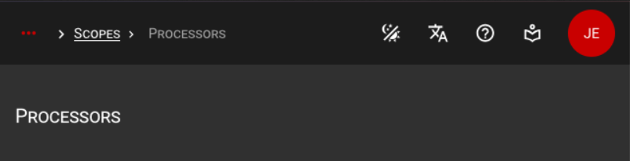
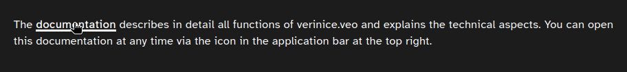
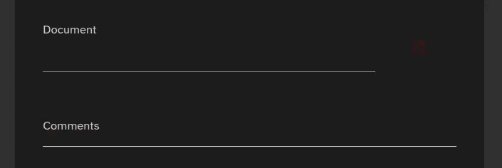
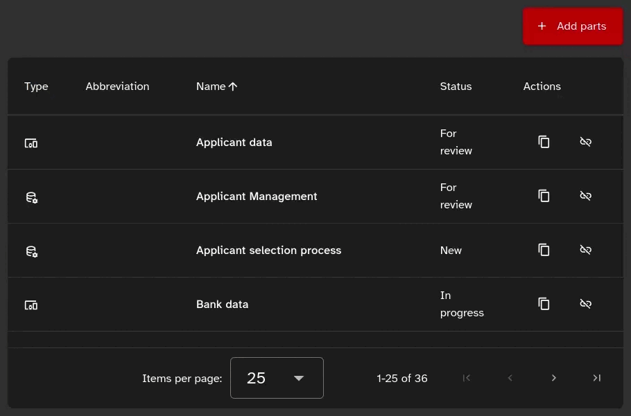
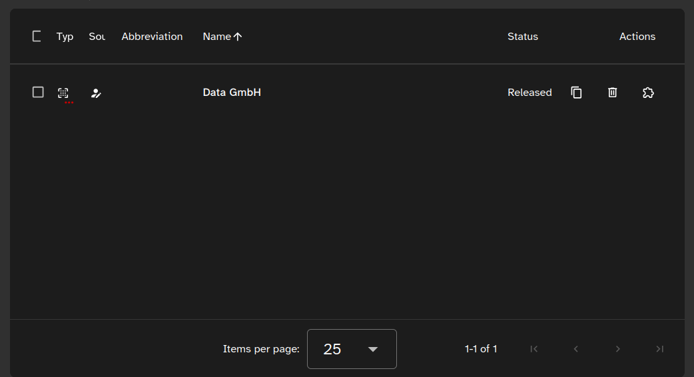

# Style guide

## Page headers

- Every page must have a heading (`<h1>`).
- The browser window title must contain the heading text.

## Links

- Clickable items that navigate to another page must be implemented as proper links (`<a>` elements).
- Links must be visually distinct from normal text and buttons:
  - Links must appear underlined.
  - When hovering over a link, the cursor must become a pointer.

## Inputs

- For text and select inputs, the label must appear as a placeholder _inside_ the input field.
- The label must slide to the top if the input field is focussed or contains data.

## Tables and lists

- Buttons that add items to a table or list, must be positioned on the right hand side above the table or list.
- In a paginated table or list, only the contained items must scroll. The buttons, table headers and pagination controls must stay fixed.

- Paginated tables and lists must take up the entire available height, so that the pagination controls stick to the bottom of the window.

